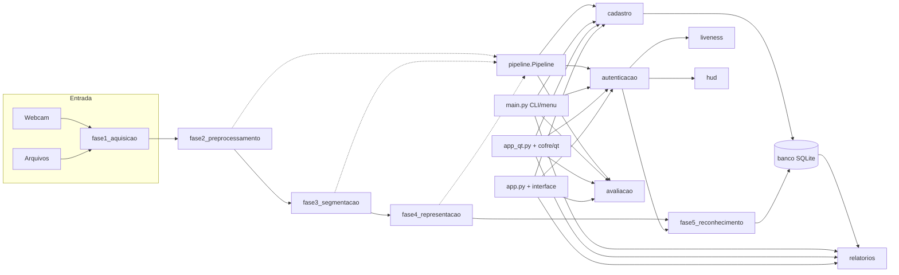
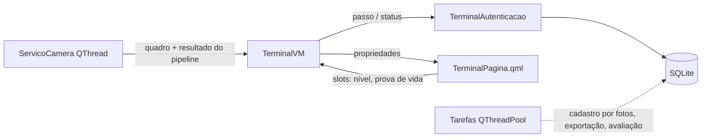
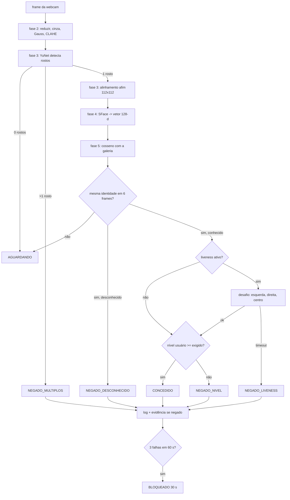

# Detalhes do software para a dissertação da APS

Este arquivo reúne o que o grupo precisa para escrever a dissertação sobre o sistema
desenvolvido. Segue a ordem das seções exigidas no enunciado (objetivo, introdução,
fundamentos, plano de desenvolvimento, projeto/estrutura, listagem de código, apresentação,
bibliografia), com os números reais obtidos nos testes e a indicação de onde cada item está
no código.

> Formatação exigida: Arial 12, espaçamento 1,5, margens 2,5 cm, A4, espiral com capa
> transparente. Limites de páginas: objetivo 1-2, introdução 2-8, fundamentos 10-20,
> plano de desenvolvimento 5-15, projeto 18-35. A listagem de código vai no Teams
> (arquivo `docs/LISTAGEM-CODIGO.md`, regenerado por `python ferramentas/listar_codigo.py`).

---

## 0. Resumo do que foi construído

Sistema de controle de acesso por reconhecimento facial em tempo real, em Python 3 com
OpenCV, que identifica a pessoa diante da webcam, compara o nível de permissão dela com o
nível exigido pela área (1 permissão geral, 2 diretores de divisão, 3 ministro) e concede ou
nega o acesso. Inclui cadastro biométrico com controle de qualidade, prova de vida por
movimento de cabeça, bloqueio após tentativas falhas, detecção de mais de uma pessoa diante
do terminal, registro de evidência fotográfica das negações, log de auditoria em SQLite,
relatórios em terminal, CSV e HTML, avaliação quantitativa do reconhecedor (TAR/FAR/EER),
um painel didático que exibe as cinco fases do processamento de imagens ao vivo, um aplicativo
desktop em PySide6 + Qt Quick com seis telas que reúne todas essas funções (a interface anterior,
em customtkinter, continua no projeto), uma área liberada por nível depois da autenticação e 96 testes automatizados.

| item | valor |
|---|---|
| linguagem / bibliotecas | Python 3.14, OpenCV 5.0 (contrib), NumPy 2.5, SQLite 3 (biblioteca padrão), PySide6 6.12 / Qt Quick (aplicativo), customtkinter 6 + Pillow (interface anterior), pytest 9 |
| detector facial | YuNet (rede neural convolucional, formato ONNX, 232 KB) |
| extrator de características | SFace (rede neural, ONNX, 38 MB) → vetor de 128 dimensões |
| medida de similaridade | cosseno, limiar 0,363 (valor oficial do OpenCV para o SFace) |
| módulos Python | 18 no pacote `cofre` + 17 em `cofre/qt` + 12 em `cofre/interface` + `main.py`, `app_qt.py` e `app.py` |
| arquivos QML | 31 (6 páginas, a área liberada com 3 telas, 19 componentes, tema e janela) + ícones em JavaScript |
| linhas de código (sem testes) | ~14.000: ~2.700 do núcleo e da CLI, ~8.050 do aplicativo Qt (~3.250 Python, ~4.800 QML), ~3.250 da interface anterior |
| testes automatizados | 96, todos passando em ~100 s (43 do núcleo, 36 da interface anterior, 17 do aplicativo Qt) |
| custo por frame | ~15-30 ms em notebook comum (frame reduzido a 640 px de largura) |

---

## 1. Objetivo e motivação (1-2 páginas)

**Objetivo geral.** Desenvolver um sistema de identificação e autenticação biométrica facial
que controle o acesso a áreas restritas segundo três níveis de permissão, aplicando as cinco
fases do processamento digital de imagens.

**Objetivos específicos** (cada um corresponde a um módulo):
1. Adquirir imagens em tempo real pela webcam e também por arquivo (`cofre/fase1_aquisicao.py`).
2. Pré-processar as imagens para reduzir efeitos de iluminação, ruído e resolução (`cofre/fase2_preprocessamento.py`).
3. Segmentar o rosto da cena, localizar pontos de referência e alinhá-lo geometricamente (`cofre/fase3_segmentacao.py`).
4. Representar o rosto por um descritor numérico compacto e comparável (`cofre/fase4_representacao.py`).
5. Reconhecer a pessoa entre os cadastrados e aplicar o esquema de níveis (`cofre/fase5_reconhecimento.py`).
6. Garantir robustez: prova de vida, bloqueio por tentativas, auditoria, relatórios e testes.

**Motivação** (pontos para desenvolver): biometria facial não exige contato nem objeto
(cartão, chave) que possa ser emprestado ou perdido; o rosto é verificado continuamente,
não só na entrada; a solução usa apenas hardware comum (webcam) e software livre; a
auditoria fotográfica responsabiliza tentativas indevidas.

---

## 2. Introdução (2-8 páginas)

Sugestão de roteiro:
1. **Contexto**: controle de acesso físico e biometria (digital, íris, face, voz). Por que a
   face: aquisição a distância, sem cooperação ativa, câmeras baratas.
2. **O problema**: identificar (1:N, "quem é?") e autenticar (verificar se a identidade
   encontrada tem permissão) em tempo real, com baixa taxa de falsa aceitação.
3. **A abordagem**: pipeline em cinco fases (aquisição → pré-processamento → segmentação →
   representação/descrição → reconhecimento/interpretação), que é exatamente a divisão
   de módulos do código.
4. **Escopo**: webcam, um terminal, até dezenas de usuários cadastrados, três níveis.
5. **Organização do texto**: resumo das seções seguintes.

Termos a definir na introdução: identificação × verificação; galeria × consulta (probe);
falsa aceitação (FAR) × falsa rejeição (FRR); limiar; *embedding*; prova de vida (*liveness*).

---

## 3. Fundamentos das principais técnicas de reconhecimento facial (10-20 páginas)

Cada tópico abaixo é usado no sistema; escrever a teoria e apontar o uso.

### 3.1 As cinco fases do processamento digital de imagens (Gonzalez & Woods)
| fase | o que é | como aparece no sistema |
|---|---|---|
| 1 Aquisição | sensor converte luz em matriz de pixels (BGR, 8 bits/canal) | `FonteCamera` lê 1280×720 da webcam; `carregar_imagem` lê arquivos |
| 2 Pré-processamento | melhora a imagem para as fases seguintes | redução para 640 px, cinza, filtro gaussiano 3×3, CLAHE no canal L do espaço LAB, métricas de nitidez/brilho |
| 3 Segmentação | separa o objeto de interesse (rosto) do fundo | YuNet devolve caixa + 5 pontos; recorte; alinhamento afim para 112×112 |
| 4 Representação e descrição | converte a região em descritor numérico | SFace → vetor de 128 números normalizado (L2 = 1); LBP para fins didáticos |
| 5 Reconhecimento e interpretação | atribui rótulo e significado | similaridade do cosseno com a galeria, limiar 0,363, decisão por nível |

### 3.2 Representação digital da imagem
Matriz H×W×3 (BGR no OpenCV), 0-255 por canal. Escala de cinza: Y = 0,299R + 0,587G + 0,114B
(`cv2.cvtColor`). Espaço LAB: L = luminância, a/b = cromaticidade; o CLAHE é aplicado só em L
para não distorcer as cores que o detector usa.

### 3.3 Filtragem espacial: suavização gaussiana
Convolução com máscara gaussiana 3×3 (σ calculado pelo OpenCV). Reduz ruído do sensor
antes da equalização, que amplifica ruído. Código: `suavizar()`.

### 3.4 Equalização de histograma e CLAHE
Equalização global redistribui as intensidades pela função de distribuição acumulada; em
cenas com fundo claro e rosto escuro ela pode piorar o rosto. CLAHE (Zuiderveld, 1994)
equaliza por blocos (grade 8×8) com limite de contraste (clip 2,0) e interpola entre blocos,
corrigindo iluminação desigual. Código: `equalizar_clahe()`; a versão global está em
`equalizar_cinza()` para comparação (bom gerar as duas imagens para a dissertação).

### 3.5 Medidas de qualidade de imagem
Nitidez = variância do Laplaciano (bordas fortes → variância alta; borrado → baixa; limite 60).
Brilho = média da intensidade (aceito entre 40 e 220). Usadas no cadastro para descartar
fotos ruins (`avaliar_qualidade()`), o que melhora a galeria.

### 3.6 Detecção de faces
- **Histórico**: Viola-Jones (2001) com características Haar + AdaBoost + cascata
  (`cv2.CascadeClassifier`, ainda incluído no OpenCV); HOG + SVM (Dalal & Triggs, 2005).
- **Usado**: YuNet (Wu, Peng & Yu, 2023), detector convolucional leve, sem âncoras, que
  devolve caixa, confiança e 5 pontos (olhos, nariz, cantos da boca). Parâmetros: score
  mínimo 0,85, NMS 0,3 (supressão de caixas sobrepostas), rosto mínimo 80 px.
- Explicar NMS (*non-maximum suppression*) e por que detectar no frame reduzido (custo
  cresce com a área da imagem).

### 3.7 Alinhamento geométrico (transformação afim)
Os 5 pontos detectados são levados a posições canônicas de um rosto 112×112 por uma
transformação afim de similaridade (rotação + escala + translação), estimada por mínimos
quadrados (`FaceRecognizerSF.alignCrop`). Assim, inclinação da cabeça e distância da câmera
deixam de influenciar a fase 4. Boa oportunidade de mostrar a matriz 2×3 da transformação.

### 3.8 Descritores clássicos
- **LBP** (Ojala et al., 2002; Ahonen et al., 2006): cada pixel vira um código de 8 bits
  comparando-o com os 8 vizinhos; histogramas por bloco descrevem textura. Implementado em
  `lbp_mapa()` e `lbp_histograma()` (painel didático, "4 LBP (textura)").
- **Eigenfaces** (Turk & Pentland, 1991) e **Fisherfaces** (Belhumeur et al., 1997): PCA/LDA
  sobre os pixels. Citar como evolução histórica (o OpenCV contrib ainda os oferece em
  `cv2.face`).

### 3.9 Descritores por aprendizado profundo (*embeddings*)
Redes treinadas com funções de perda métricas (FaceNet/triplet loss, ArcFace, SFace)
aprendem a mapear rostos em uma hiperesfera onde a mesma pessoa fica próxima e pessoas
diferentes ficam distantes. O SFace (Zhong & Deng, 2021) usa a perda *sigmoid-constrained
hypersphere*; o modelo do OpenCV Zoo recebe 112×112 BGR e devolve 128 valores. O sistema
normaliza o vetor (norma 1) e armazena como BLOB de 512 bytes no SQLite.

### 3.10 Comparação e decisão
Similaridade do cosseno: cos θ = (a·b)/(‖a‖‖b‖); com vetores normalizados é só o produto
interno, por isso a galeria inteira é comparada com uma multiplicação matriz×vetor
(`Reconhecedor.identificar`). Identificação 1:N: maior similaridade por usuário; aceita se
≥ 0,363. Autorização: nível do usuário ≥ nível exigido.

### 3.11 Métricas de avaliação biométrica
TAR (aceitação verdadeira), FAR (falsa aceitação), FRR = 1 − TAR, EER (ponto em que
FAR = FRR), curva de varredura de limiar. Implementadas em `cofre/avaliacao.py`; resultados
na seção 6.

### 3.12 Prova de vida (anti-spoofing)
Ataques de apresentação: foto impressa, foto no celular, vídeo, máscara. Métodos: desafio-
resposta (piscar, virar a cabeça), análise de textura, profundidade/IR. O sistema usa
desafio de movimento: a razão horizontal nariz/olhos (yaw ≈ (x_nariz − x_meio_olhos)/d_olhos)
precisa ficar ≤ −0,22 (esquerda), depois ≥ +0,22 (direita), depois voltar ao centro em até
12 s. Uma foto plana não muda essa razão. Durante todo o desafio a identidade é conferida a cada
quadro: se outra pessoa assume a frente da câmera ou o rosto deixa de ser reconhecido, a tentativa
acaba em NEGADO_LIVENESS (sem isso, alguém poderia começar a validação e outra pessoa terminar o
movimento e entrar com o perfil da primeira). Limitação: vídeo de alta qualidade pode enganar.

### 3.13 Biometria, segurança e LGPD
Dado biométrico é dado pessoal sensível (LGPD, art. 5º, II). O sistema guarda apenas o vetor
(não reversível em imagem com precisão) e fotos de referência locais; discutir consentimento,
finalidade e retenção das evidências.

---

## 4. Plano de desenvolvimento da aplicação (5-15 páginas)

### 4.1 Tecnologias e ferramentas
| ferramenta | versão | papel |
|---|---|---|
| Python | 3.14 (funciona em ≥ 3.10) | linguagem principal (listada no enunciado) |
| OpenCV contrib | 5.0 | aquisição, filtros, CLAHE, YuNet, SFace, interface de vídeo |
| NumPy | 2.5 | matrizes, produto interno da galeria, LBP vetorizado |
| SQLite 3 | biblioteca padrão | usuários, amostras (embeddings) e log de acessos |
| ONNX (OpenCV Zoo) | YuNet 2023mar, SFace 2021dec | pesos das redes neurais pré-treinadas |
| PySide6 (Qt 6, Qt Quick/QML) | 6.12 | aplicativo desktop: interface declarativa em QML, ViewModels em Python, câmera em QThread |
| customtkinter | 6.0 | interface anterior (tema escuro, sobre o Tkinter da biblioteca padrão) |
| Pillow | 13 | converte os frames do OpenCV para exibição na interface anterior |
| pytest | 9 | 96 testes automatizados |
| Git | - | versionamento (`.gitignore` exclui banco, fotos e evidências) |

Por que não TensorFlow/Keras: o enunciado permite, mas o OpenCV já embute a inferência das
redes (módulo DNN), sem dependência pesada e com tempo real em CPU. Por que SQLite e não
MySQL: zero configuração e banco em um arquivo; a camada `banco.py` isola o SQL, e a troca
para MySQL (XAMPP) exigiria apenas trocar o driver (`mysql-connector-python`) e os
placeholders `?` por `%s`.

### 4.2 Requisitos funcionais
| id | requisito | onde |
|---|---|---|
| RF01 | cadastrar usuário com nome, matrícula, cargo e nível (1-3) | `cadastro.py`, `banco.criar_usuario` |
| RF02 | capturar 18 amostras pela webcam, em 9 poses, com controle de qualidade | `cadastrar_pela_camera`, `INSTRUCOES_POSE` |
| RF03 | cadastrar a partir de fotos de arquivo (scanner/câmera externa) | `cadastrar_de_imagens` |
| RF04 | detectar e reconhecer rostos em tempo real | `autenticacao.TerminalAutenticacao` |
| RF05 | conceder/negar acesso conforme nível exigido pela área | `fase5_reconhecimento.decidir_acesso` |
| RF06 | exigir identidade estável em 6 frames seguidos antes de decidir | `Confirmador` |
| RF07 | prova de vida por movimento de cabeça (ligável/desligável), com a mesma identidade do começo ao fim | `liveness.DesafioMovimento`, `TerminalAutenticacao.passo` |
| RF08 | bloquear o terminal por 30 s após 3 negações em 60 s | `liveness.ControleTentativas` |
| RF09 | recusar quando houver mais de um rosto (carona) | `config.BLOQUEAR_MULTIPLOS_ROSTOS` |
| RF10 | registrar toda tentativa (data, pessoa, nível, área, similaridade, resultado) | `banco.registrar_acesso` |
| RF11 | salvar foto-evidência das tentativas negadas | `autenticacao.salvar_evidencia` |
| RF12 | listar, remover, ativar/desativar e mudar nível de usuários | `main.py`, `qt/vm_usuarios.py`, `interface/tela_usuarios.py` |
| RF13 | relatórios em terminal, CSV e HTML com estatísticas | `relatorios.py` |
| RF14 | avaliar o reconhecedor com métricas TAR/FAR/EER | `avaliacao.py` |
| RF15 | painel didático das 5 fases ao vivo e em imagem | `hud.mosaico`, `demo.py` |
| RF16 | trocar a área/nível exigido durante a execução (teclas 1-3 ou o seletor de área do aplicativo) | `TerminalAutenticacao.definir_nivel` |
| RF17 | aplicativo desktop com todas as funções em uma janela | `app_qt.py`, `cofre/qt/` (anterior: `app.py`, `cofre/interface/`) |
| RF18 | ajustar os parâmetros sem reiniciar e salvá-los em arquivo | `cofre/parametros.py`, `qt/vm_config.py` |
| RF19 | confirmar ações destrutivas (remover usuário, cancelar cadastro com amostras) | `UsuariosPagina.qml`, `CadastroPagina.qml` |
| RF20 | não avaliar rosto fora da pose aceitável (virado, inclinado, cabeça baixa/erguida, borrado): orientar a pessoa sem contar tentativa | `Rosto.problema_pose`, `TerminalAutenticacao.passo` |
| RF21 | depois de um acesso concedido, abrir a área liberada do nível da pessoa (nível N enxerga as áreas 1..N), com dados de demonstração, fechando por inatividade ou pelo botão | `areas.py`, `qt/vm_sessao.py`, `AreaLiberada.qml` |

### 4.3 Requisitos não funcionais
Tempo real (≥ 15 fps em CPU), funcionar sem internet, dados locais, código em português com
docstrings explicando cada fase, tratamento de erros (câmera ausente, modelo ausente,
matrícula duplicada, nível inválido, imagem ilegível, rosto não encontrado), testes
automatizados, portabilidade (macOS, Windows, Linux).

### 4.4 Metodologia e cronograma
Desenvolvimento incremental por fase do PDI: (1) aquisição e exibição; (2) pré-processamento
com inspeção visual; (3) detecção e alinhamento; (4) embedding e medição de similaridade em
fotos conhecidas; (5) decisão, banco e interface; (6) extras de segurança; (7) relatórios,
testes e documentação. Preencher as datas reais do grupo na ficha de APS.

---

## 5. Projeto (estrutura e módulos) do programa (18-35 páginas)

### 5.1 Arquitetura


O aplicativo Qt separa quatro camadas: **QML** (só apresentação: páginas e componentes),
**ViewModels** (`cofre/qt/vm_*.py`, expõem propriedades e slots ao QML e chamam o núcleo),
**serviços** (`camera.py` com captura em `QThread`, `tarefas.py` com trabalhos em `QThreadPool`,
`imagens.py` com o provedor de miniaturas) e o **núcleo** já existente (pipeline, terminal,
cadastro, banco, relatórios). O QML nunca decide uma autorização: ele mostra o `status()` e a
decisão do `TerminalAutenticacao`, e se a leitura falhar o painel volta ao estado neutro.



As duas entradas (linha de comando e aplicativo desktop) usam as mesmas classes de lógica.
Para isso o cadastro e o terminal foram separados da janela do OpenCV: `SessaoCadastro.passo()`
e `TerminalAutenticacao.passo()` recebem um frame e atualizam o estado, e cada interface só
desenha o resultado. Assim a regra de negócio fica em um lugar só e é testada uma vez.

### 5.2 Descrição dos módulos
| módulo | responsabilidade | principais classes/funções |
|---|---|---|
| `config.py` | todos os parâmetros ajustáveis | `NIVEIS`, `AREAS`, `LIMIAR_COSSENO`, `FRAMES_CONFIRMACAO`, limiares de qualidade, pose (`POSE_*`) e liveness, `SESSAO_LIBERADA_SEG` |
| `fase1_aquisicao.py` | webcam e arquivos | `FonteCamera` (context manager, espelhamento, FPS), `carregar_imagem`, `listar_imagens` |
| `fase2_preprocessamento.py` | filtros e qualidade | `preprocessar` → `ResultadoPreprocessamento` com todas as imagens intermediárias; `Qualidade` |
| `fase3_segmentacao.py` | detecção e geometria | `DetectorFacial` (YuNet), `Rosto` (caixa, 5 pontos, `yaw()`, `roll()`, `razao_nariz()`, `problema_pose()`, `escalar()`), `recortar`, `alinhar` |
| `fase4_representacao.py` | descritores | `ExtratorCaracteristicas` (SFace), `similaridade_cosseno`, `lbp_mapa`, `lbp_histograma` |
| `fase5_reconhecimento.py` | decisão | `Reconhecedor` (galeria em matriz N×128, `identificar`, `amostra_mais_parecida` só para exibição), `Identificacao`, `Decisao`, `decidir_acesso`, enum `Resultado` |
| `pipeline.py` | encadeia 2→3→4 | `Pipeline.processar(frame)` → `ResultadoPipeline` (lista de `RostoProcessado`) |
| `banco.py` | persistência | `Banco` com CRUD de usuários, amostras, acessos e `estatisticas()` |
| `liveness.py` | anti-fraude | `DesafioMovimento` (máquina de estados), `ControleTentativas` |
| `autenticacao.py` | terminal em tempo real | `TerminalAutenticacao` (estados), `Confirmador`, `autenticar_imagem` |
| `cadastro.py` | enrollment | `cadastrar_pela_camera`, `cadastrar_de_imagens`, `DadosCadastro` |
| `relatorios.py` | saída para humanos | `texto_usuarios`, `texto_acessos`, `texto_estatisticas`, `exportar_csv`, `exportar_html` |
| `avaliacao.py` | métricas | `avaliar_pasta` → `ResultadoAvaliacao.taxas/varredura/eer/resumo` |
| `hud.py` | desenho na tela | `caixa_rosto`, `painel_topo`, `faixa_resultado`, `barra_similaridade`, `mosaico` |
| `demo.py` | painel das 5 fases | `demonstrar_imagem` |
| `main.py` | CLI (argparse) e menu | subcomandos `cadastrar`, `autenticar`, `usuarios`, `remover`, `nivel`, `ativar`, `desativar`, `relatorio`, `avaliar`, `demo` |
| `app.py` | entrada da interface anterior (customtkinter) | `executar(caminho_db)` |
| `interface/app.py` | janela principal | `App` (barra lateral, troca de telas, carrega os modelos em thread, ciclo de ~30 Hz) |
| `interface/camera.py` | câmera fora da thread da janela | `ServicoCamera` (captura e pipeline em thread, entrega o último resultado) |
| `interface/tela_terminal.py` | autenticação ao vivo | `TelaTerminal` (usa `TerminalAutenticacao.passo` e `status()`) |
| `interface/tela_cadastro.py` | enrollment | `TelaCadastro` (formulário validado, usa `SessaoCadastro`) |
| `interface/tela_usuarios.py` | administração | `TelaUsuarios` (busca, nível, ativar, fotos, remover) |
| `interface/tela_acessos.py` | auditoria | `TelaAcessos` (filtros, resumos, detalhe com evidência, exportação em thread) |
| `interface/tela_ferramentas.py` | demonstração | `TelaFerramentas` (5 fases, autenticação por imagem, TAR/FAR/EER) |
| `interface/tela_config.py` | parâmetros | `TelaConfig` (19 campos com intervalo validado, salvar/carregar JSON) |
| `interface/widgets.py`, `tema.py`, `base.py` | componentes comuns | `VideoWidget`, `Cartao`, `Faixa`, `Tabela`, `BarraStatus`, `Tela` |
| `parametros.py` | parâmetros ajustáveis (sem interface) | `Campo`, `CAMPOS`, `aplicar`, `ler_arquivo`, `salvar_arquivo` |
| `app_qt.py`, `qt/app.py` | entrada do aplicativo Qt | `executar`, `criar_motor` (QML), `destruir_motor` |
| `qt/aplicacao.py` | raiz do aplicativo Qt | `Aplicacao` (banco, câmera, tarefas, navegação, carrega os modelos em segundo plano) |
| `qt/camera.py` | câmera fora da thread da interface | `ServicoCamera`, `_ThreadCaptura` (QThread, entrega só o quadro mais recente, libera a câmera ao sair) |
| `qt/tarefas.py`, `qt/imagens.py`, `qt/video.py` | serviços de apoio | `Tarefas` (QThreadPool), provedor de imagens, `VisorVideo` (QQuickPaintedItem) |
| `qt/vm_terminal.py` … `qt/vm_config.py` | um ViewModel por tela | `TerminalVM`, `CadastroVM`, `UsuariosVM`, `AcessosVM`, `AvaliacaoVM`, `ConfigVM` |
| `areas.py`, `qt/vm_sessao.py`, `AreaLiberada.qml`, `AreaComum.qml`, `AreaDiretores.qml`, `AreaCofre.qml` | área liberada após a concessão | `areas_liberadas`, `conteudo`; `SessaoVM.abrir` (só pela `Decisao` do backend, reconfere o usuário no banco), `conteudo(n)` vazio acima do nível, `encerrar`, fechamento por inatividade |
| `qt/qml/Cofre/Ui/*.qml` | apresentação | `Main.qml`, seis páginas, `Theme.qml` e componentes (`Botao`, `Painel`, `Confirmacao`, `Vazio`…) |

### 5.3 Fluxo de autenticação (por frame)


### 5.4 Máquina de estados do terminal
AGUARDANDO → CONFIRMANDO (há 1 rosto) → LIVENESS (identidade confirmada e liveness ligado)
→ RESULTADO (exibe 3 s, registra) → AGUARDANDO ou BLOQUEADO. Código em
`TerminalAutenticacao.passo()`; testado sem webcam em `tests/test_terminal.py`.

No aplicativo Qt, quando o RESULTADO é CONCEDIDO, `TerminalVM` entrega a `Decisao` ao `SessaoVM`,
que reconfere a pessoa no banco (existe, ativa, nível ≥ exigido) e abre a área liberada; a
câmera fica pausada e a navegação travada até a sessão encerrar (botão ou `SESSAO_LIBERADA_SEG`
de inatividade), e aí o terminal volta a AGUARDANDO.

### 5.5 Fluxo de cadastro
Dados pessoais no terminal → abre webcam → a cada 1,5 s, se houver exatamente um rosto com
nitidez ≥ 60 e brilho entre 40 e 220, salva recorte em `data/fotos/<id>_<matrícula>/NN.jpg`
e o embedding no banco → 9 instruções de pose, 2 amostras cada, ao longo das 18 amostras
(frente, virar para cada lado, inclinar para cada lado, queixo para cima, queixo para baixo
"como se olhasse o celular", frente de novo, sorrir) → ESC desfaz tudo. As poses de giro e de
cabeça baixa entraram depois de medir 69 quadros reais: 11 negações eram de alguém cadastrado
só de frente olhando para baixo ou de lado.

O intervalo começou em 0,4 s e foi aumentado para 1,5 s depois do teste com a câmera real:
com 0,4 s as 12 amostras de então saíam em 6 s, cada instrução de pose ficava 0,8 s na tela e o cadastro
ficava quase todo de frente. Nas 50 fotos reais do terminal, 44 passaram do limiar, e as que
falharam eram quase todas de cabeça virada ou com o rosto na borda do quadro.

### 5.6 Modelo de dados
```mermaid
erDiagram
    usuarios ||--o{ amostras : possui
    usuarios ||--o{ acessos : gera
    usuarios { int id PK; text nome; text matricula UK; text cargo; int nivel "1..3"; int ativo; text criado_em }
    amostras { int id PK; int usuario_id FK; blob embedding "128 x float32"; text caminho_foto; real nitidez; real brilho; text criado_em }
    acessos { int id PK; text data_hora; int usuario_id FK "nulo se desconhecido"; text nome_detectado; int nivel_usuario; int nivel_exigido; text area; real similaridade; text resultado; text mensagem; text evidencia }
```
Resultados possíveis em `acessos.resultado`: CONCEDIDO, NEGADO_NIVEL, NEGADO_DESCONHECIDO,
NEGADO_LIVENESS, NEGADO_MULTIPLOS, BLOQUEADO.

### 5.7 Parâmetros e justificativas (`config.py`)
| parâmetro | valor | justificativa |
|---|---|---|
| LARGURA_PROCESSAMENTO | 640 px | detecção 4× mais rápida que em 1280 px sem perder rostos ≥ 80 px |
| CLAHE_CLIP / GRADE | 2,0 / 8×8 | valores padrão da literatura; evita amplificar ruído |
| DETECCAO_SCORE_MIN | 0,85 | reduz falsos positivos (objetos parecidos com rosto) |
| LIMIAR_COSSENO | 0,363 | limiar oficial do OpenCV para o SFace; na avaliação deu FAR 0% |
| FRAMES_CONFIRMACAO | 6 | ~0,3 s a 20 fps; elimina oscilações entre identidades |
| LIVENESS_LIMIAR_YAW | 0,22 | virada clara da cabeça sem exigir perfil completo |
| MAX_TENTATIVAS / BLOQUEIO | 3 em 60 s / 30 s | padrão de controles de acesso contra força bruta |
| MIN_NITIDEZ | 60 | abaixo disso o recorte 112×112 está visivelmente borrado |
| POSE_MAX_YAW | 0,60 | rostos de frente medem até ±0,45 nos 69 quadros reais; acima disso o terminal pede para virar para a câmera |
| POSE_MAX_ROLL_GRAUS | 25° | inclinação da linha dos olhos; retos ficam abaixo de 20° |
| POSE_RAZAO_NARIZ_MIN/MAX | 0,35 / 0,80 | posição do nariz entre olhos e boca; de frente fica em 0,5-0,7 |
| AMOSTRAS_POR_CADASTRO | 18 | 9 poses × 2 amostras, 27 s de cadastro a 1,5 s por amostra |

O filtro de pose só vale para o terminal em AGUARDANDO/CONFIRMANDO. Na prova de vida a
pessoa precisa girar a cabeça e no cadastro as poses são pedidas de propósito. Limite do
método: os 5 pontos do YuNet medem bem giro e inclinação, mas pouco a cabeça baixa (a razão do
nariz quase não muda), então a cobertura de "olhando para baixo" vem do cadastro, não do filtro.

### 5.8 Tratamento de erros
Câmera indisponível → `ErroAquisicao` com instrução de permissão no macOS; modelo ONNX
ausente → `FileNotFoundError` com o caminho; matrícula repetida → `IntegrityError` tratado no
CLI; nível fora de 1-3 → `ValueError`; imagem ilegível ou sem rosto no cadastro por arquivo
→ aviso por arquivo e cancelamento se nenhuma amostra válida; galeria vazia → sempre
"desconhecido"; frames pretos iniciais da webcam → descartados por 5 s; acentos nas fontes do
OpenCV → removidos automaticamente (`hud.sem_acentos`).

O aplicativo desktop trata os mesmos erros sem fechar: câmera indisponível vira uma mensagem
na área do vídeo com o botão "Tentar câmera novamente"; falha ao carregar os modelos aparece
na barra de status; uma tela que falhar ao abrir mostra o erro no lugar dela e as outras
continuam funcionando; formulários são validados antes de gravar; exportações rodam em
thread para a janela não travar.

### 5.9 Funções extras (contam na nota)
Prova de vida; bloqueio por tentativas; detecção de carona; evidências fotográficas;
controle de qualidade no cadastro; confirmação multi-frame; troca de área ao vivo; painel
didático das 5 fases; LBP didático; relatório HTML/CSV com estatísticas por pessoa/dia/área;
avaliação TAR/FAR/EER; usuários desativáveis sem apagar histórico; cadastro por arquivos;
autenticação offline em imagem; menu interativo e CLI; aplicativo desktop com seis telas;
ajuste de parâmetros ao vivo com arquivo de configuração; aplicativo Qt Quick; filtro de pose no terminal; área liberada por nível depois da autenticação; 96 testes.

---

## 6. Resultados dos testes (para a seção de projeto ou um capítulo de resultados)

### 6.1 Avaliação do reconhecedor (`python main.py avaliar tests/fixtures/pessoas`)
Conjunto: 2 pessoas × 2 fotos oficiais de domínio público (anos diferentes, 2009/2012 e
2013/2021). Pares genuínos 2, impostores 4.

| medida | valor |
|---|---|
| similaridade genuína (mesma pessoa) | 0,697 a 0,813 (média 0,734) |
| similaridade impostora (pessoas diferentes) | 0,087 a 0,270 (média 0,133) |
| no limiar 0,363 | TAR 100 %, FRR 0 %, FAR 0 % |
| EER | 0 % (qualquer limiar entre 0,27 e 0,69 separa o conjunto) |

O conjunto é pequeno; o grupo deve repetir com as próprias fotos (pasta `pessoa/*.jpg`,
5-10 fotos por integrante com iluminação e ângulos variados) e colocar a tabela da
varredura de limiares na dissertação.

### 6.2 Testes automatizados (`python -m pytest -q`)
| arquivo | o que cobre | testes |
|---|---|---|
| `test_pipeline.py` | etapas do pré-processamento, qualidade, detecção, embedding normalizado, mesma/outra pessoa, LBP, painel didático | 7 |
| `test_banco_reconhecimento.py` | CRUD, unicidade, 9 combinações de nível × área, desconhecido, identificação 1:N com fotos reais, galeria vazia, log e evidência, exportação CSV/HTML, avaliação | 17 |
| `test_liveness.py` | desafio aprovado, timeout, foto estática, bloqueio e expiração, janela, confirmador | 6 |
| `test_terminal.py` | máquina de estados sem webcam: concessão, negação por nível + bloqueio, desconhecido, liveness, perda do rosto, troca de pessoa no meio da prova de vida | 6 |
| `test_pose.py` | medidas de pose pelos 5 pontos e limites de `config`, pose ruim e imagem borrada não tentam nem contam falha, prova de vida fora do filtro, cadastro percorre as 9 poses | 5 |
| `test_areas.py` | herança de níveis (N enxerga 1..N), conteúdo fictício por nível, determinístico, nível inexistente | 2 |
| `test_interface_terminal.py` | concede e nega por nível, atalhos e painel didático, erro de câmera e "tentar novamente", liga/desliga a câmera ao trocar de tela | 5 |
| `test_interface_cadastro.py` | validação do formulário, captura até concluir, cancelar desfaz, cadastro por fotos, foto sem rosto, câmera indisponível | 7 |
| `test_interface_usuarios.py` | tabela e cartões, busca, nível, ativar/desativar, diálogo, fotos, remoção com confirmação | 7 |
| `test_interface_acessos.py` | cartões e resumos, filtros, detalhe com evidência, exportação CSV/HTML | 4 |
| `test_interface_ferramentas.py` | demo das 5 fases, imagem sem rosto ou inválida, autenticação por imagem, avaliação | 6 |
| `test_interface_config.py` | formulário, limites, padrões, salvar/carregar, arquivo inválido, aplicação ao abrir | 7 |
| `test_qt_app.py` | aplicativo Qt sem janela: páginas sem avisos do QML, erro de câmera, concessão igual à do backend, negação + bloqueio sem nunca mostrar "concedido" e com controles travados, liberação da câmera, cadastro (validação, fotos, câmera, cancelar, fechar no meio), usuários, auditoria e exportação, avaliação, configurações, orientação de pose e leituras do rosto, área liberada (abre só com concessão do backend, conteúdo vazio acima do nível, câmera pausada, navegação travada, fecha por inatividade, usuário desativado não abre) | 17 |

Os testes da interface abrem a janela de verdade com uma câmera falsa que repete fotos de
`tests/fixtures` (`tests/apoio_interface.py`), então rodam sem webcam e sem intervenção.

### 6.3 Prints para a dissertação e apresentação
1. `python main.py demo <foto>` → painel das 5 fases (salvo em `data/relatorios/demo_<nome>.png`).
2. Tela de cadastro com a barra "Amostras: n/18" e a instrução de pose.
3. Autenticação: concedido (faixa verde), negado por nível (vermelho), desconhecido, bloqueado.
4. Prova de vida com a instrução "Vire o rosto para a ESQUERDA" e o valor de yaw.
5. Dois rostos na cena com rótulo "extra".
6. `python main.py autenticar --didatico` com a janela "Pipeline (5 fases)" ao lado.
7. Relatório HTML aberto no navegador e a tabela do terminal (`relatorio`).
8. Saída do `avaliar` e do `pytest`.
9. Pasta `data/evidencias` com as fotos das negações.
10. Aplicativo desktop (`python app_qt.py`): uma captura de cada tela, de preferência com
    usuários cadastrados e algumas tentativas no log (terminal concedido, negado e bloqueado).
11. Área liberada depois de um acesso concedido: uma captura por nível (área comum, sala dos
    diretores, cofre) e uma com o cadeado da área acima do nível da pessoa.

---

## 7. Interdisciplinaridade (exigida na dissertação)
- **PIVC**: as cinco fases, filtros, equalização, segmentação, descritores.
- **Álgebra linear**: imagem como matriz, transformação afim 2×3, produto interno/cosseno, normalização L2, multiplicação matriz×vetor na galeria.
- **Estatística/probabilidade**: histograma, variância do Laplaciano, limiar de decisão, TAR/FAR/EER, média móvel do FPS.
- **Inteligência artificial**: redes convolucionais (YuNet, SFace), aprendizado métrico, inferência com ONNX.
- **Banco de dados**: modelo relacional, chaves estrangeiras com cascata, índices, consultas agregadas dos relatórios.
- **Engenharia de software**: arquitetura em camadas, máquina de estados, testes automatizados, CLI, tratamento de erros, versionamento.
- **Segurança da informação**: autenticação × autorização, níveis de privilégio, anti-spoofing, bloqueio por tentativas, auditoria e evidências.
- **Direito/ética**: LGPD e dados biométricos sensíveis, consentimento, retenção.
- **Interação humano-computador**: HUD com cores, instruções e feedback em tempo real; aplicativo desktop com navegação lateral, validação de formulários e mensagens de erro acionáveis.

---

## 8. Limitações e trabalhos futuros
Prova de vida vulnerável a vídeo (adicionar detecção de piscada com marcos faciais ou
câmera IR/profundidade); desempenho em óculos escuros/máscara; iluminação muito baixa;
galeria em memória (ok até milhares de usuários; acima disso, índice vetorial); um terminal
por processo (futuro: cliente/servidor, MySQL central, painel web); criptografia do banco
em repouso; gêmeos idênticos.

Defeito conhecido, não corrigido por mexer em controles de segurança: `Confirmador`,
`DesafioMovimento` e `ControleTentativas` recebem `FRAMES_CONFIRMACAO`, `LIVENESS_LIMIAR_YAW`,
`LIVENESS_TIMEOUT_SEG`, `MAX_TENTATIVAS_FALHAS` e `BLOQUEIO_SEG` como argumentos padrão, avaliados
quando o módulo é importado. Mudar esses valores depois (tela de configurações ou
`config_usuario.json`) não altera o comportamento. O aplicativo Qt mostra esses campos como
somente leitura; a correção é ler `config` no construtor (`n=None` → `config.FRAMES_CONFIRMACAO`).

---

## 9. Roteiro da apresentação (30 % da nota)
1. Problema e níveis de acesso, abrindo o aplicativo desktop (`python app_qt.py`) (1 min).
2. Pipeline das 5 fases com `demo` em uma foto de um integrante (3 min).
3. Cadastro ao vivo de um integrante (2 min).
4. Autenticação ao vivo: concedido no nível certo (a área liberada abre; encerrar pelo botão),
   negado em nível superior (tecla 3 ou o seletor de área),
   desconhecido (integrante não cadastrado), foto no celular barrada pela prova de vida,
   duas pessoas na frente, bloqueio após 3 falhas (5 min).
5. Relatório HTML e evidências (1 min).
6. `pytest` e `avaliar` mostrando as métricas (1 min).
7. Limitações e perguntas.

Antes da apresentação: cadastrar os integrantes em casa (`cadastrar`), testar a câmera do
computador que será usado, levar o venv pronto e um banco com histórico para o relatório.

---

## 10. Bibliografia sugerida (ABNT, conferir dados antes de usar)
- GONZALEZ, R. C.; WOODS, R. E. *Processamento digital de imagens*. 3. ed. São Paulo: Pearson, 2010.
- ZUIDERVELD, K. Contrast Limited Adaptive Histogram Equalization. In: *Graphics Gems IV*. Academic Press, 1994. p. 474-485.
- VIOLA, P.; JONES, M. Rapid object detection using a boosted cascade of simple features. *CVPR*, 2001.
- WU, W.; PENG, H.; YU, S. YuNet: a tiny millisecond-level face detector. *Machine Intelligence Research*, v. 20, p. 656-665, 2023.
- OJALA, T.; PIETIKÄINEN, M.; MÄENPÄÄ, T. Multiresolution gray-scale and rotation invariant texture classification with local binary patterns. *IEEE TPAMI*, v. 24, n. 7, 2002.
- AHONEN, T.; HADID, A.; PIETIKÄINEN, M. Face description with local binary patterns: application to face recognition. *IEEE TPAMI*, v. 28, n. 12, 2006.
- TURK, M.; PENTLAND, A. Eigenfaces for recognition. *Journal of Cognitive Neuroscience*, v. 3, n. 1, 1991.
- BELHUMEUR, P.; HESPANHA, J.; KRIEGMAN, D. Eigenfaces vs. Fisherfaces. *IEEE TPAMI*, v. 19, n. 7, 1997.
- SCHROFF, F.; KALENICHENKO, D.; PHILBIN, J. FaceNet: a unified embedding for face recognition and clustering. *CVPR*, 2015.
- DENG, J. et al. ArcFace: additive angular margin loss for deep face recognition. *CVPR*, 2019.
- ZHONG, Y.; DENG, W. et al. SFace: sigmoid-constrained hypersphere loss for robust face recognition. *IEEE Transactions on Image Processing*, v. 30, 2021.
- OPENCV. *OpenCV documentation: DNN-based face detection and recognition*. Disponível em: https://docs.opencv.org/. OpenCV Zoo: https://github.com/opencv/opencv_zoo.
- JAIN, A. K.; ROSS, A.; NANDAKUMAR, K. *Introduction to Biometrics*. Springer, 2011.
- BRASIL. Lei nº 13.709, de 14 de agosto de 2018 (LGPD).
- Fotos de teste: retratos oficiais do governo dos EUA em domínio público (ver `tests/fixtures/FONTES.md`).
